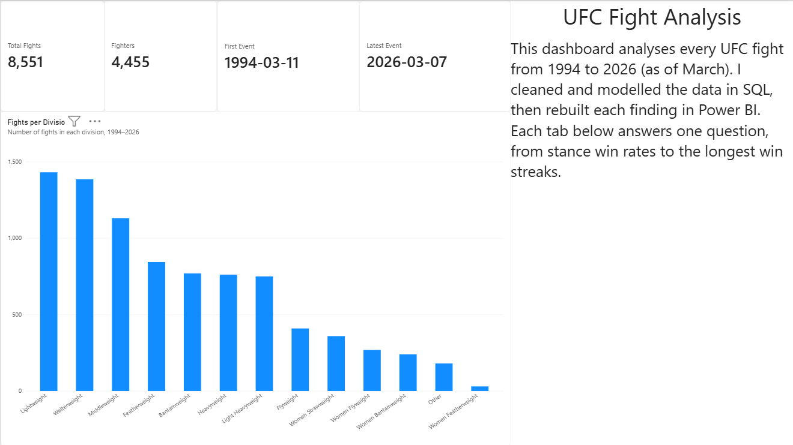
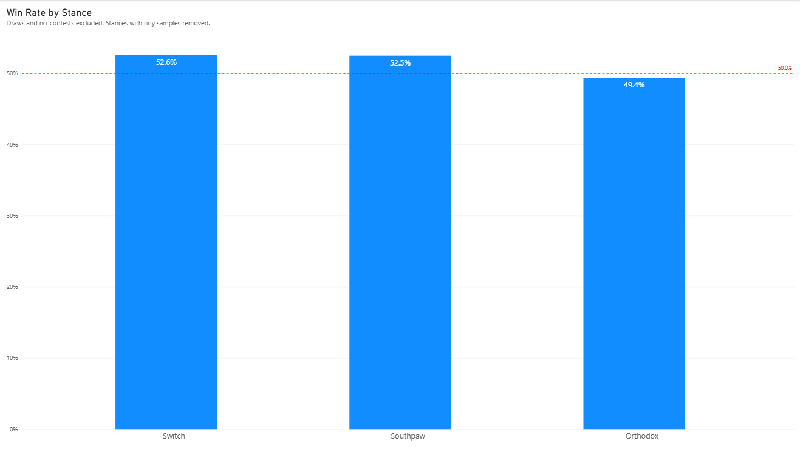
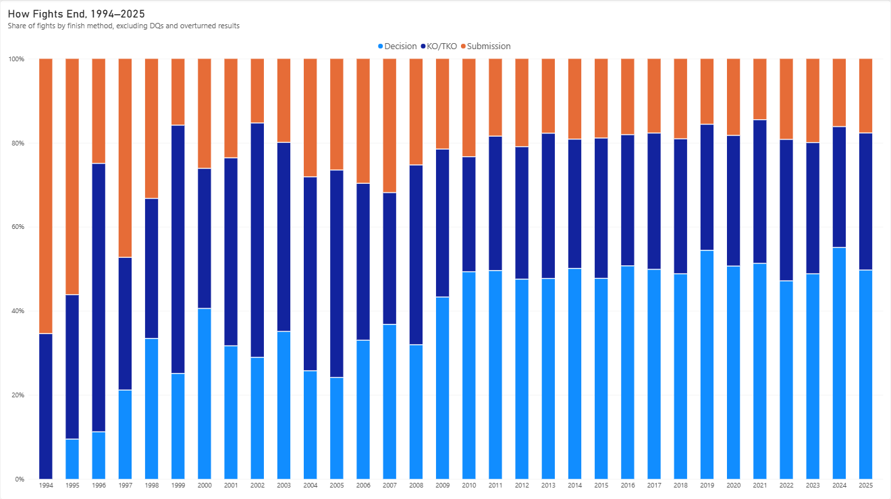
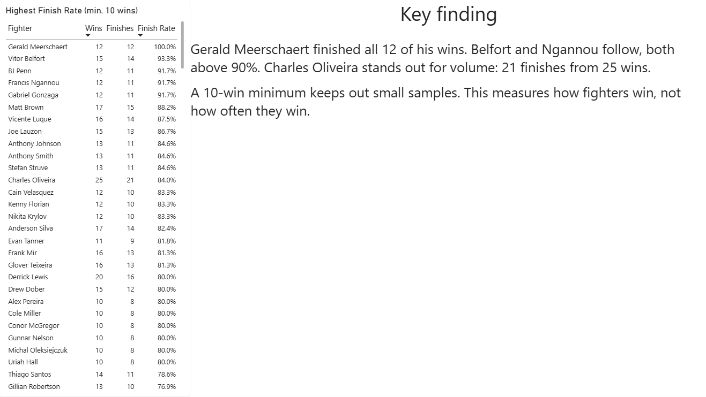
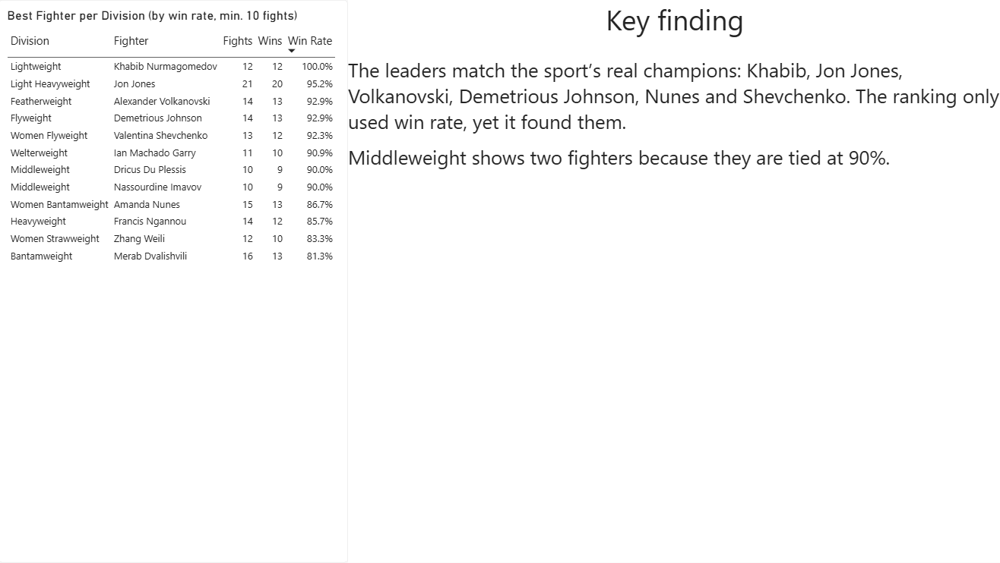
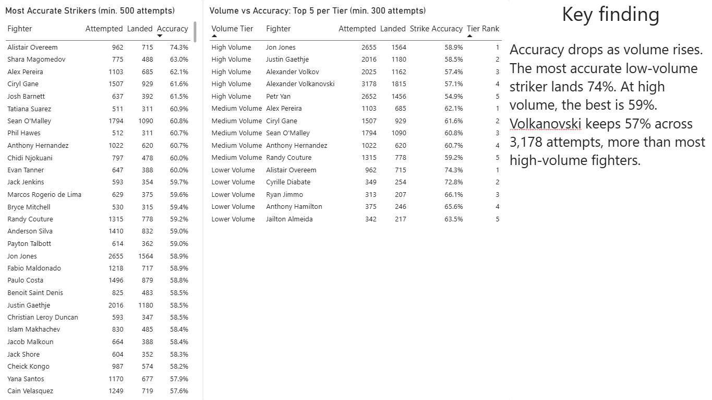
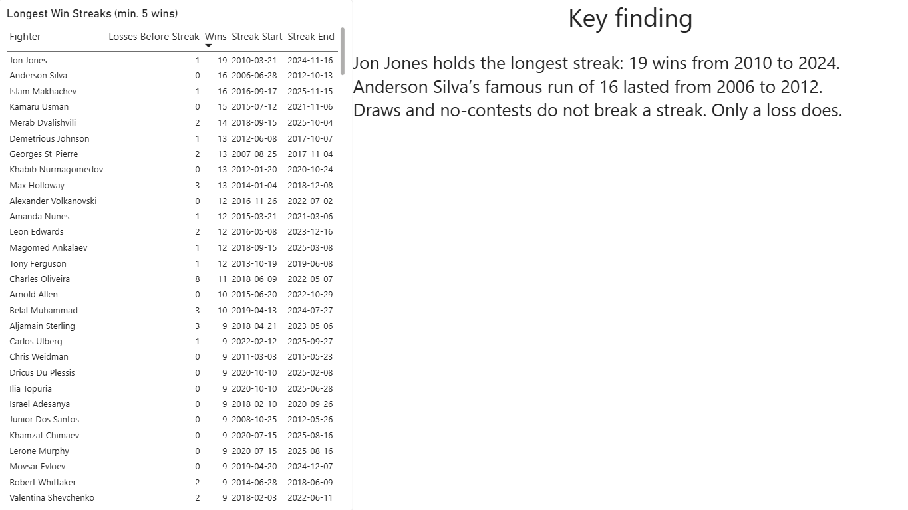

# UFC Fight Analysis: Power BI Dashboard

This project is a Power BI dashboard built on 32 years of UFC data (8,500+ fights, 4,400+ fighters, March 1994 to March 2026). It rebuilds the six findings from my [SQL analysis](https://github.com/Mustafa-GitHub/ufc-fight-analysis-sql), with an overview page and one page per finding.

## Pages

**Overview:** headline numbers and fights per division

**Stance:** win rate by stance, against the 50% baseline

**Finish Methods:** how fights ended each year, 1994 to 2025

**Finishers:** highest finish rate, minimum 10 wins

**Division Leaders:** best win rate in each division, minimum 10 fights

**Striking:** accuracy leaders, and how accuracy changes with volume

**Win Streaks:** the longest unbeaten runs in UFC history

## How It Was Built

**Power Query**

- Cleaned messy weight class labels into 13 divisions with a conditional column.
- Grouped 10 finish methods into Decision, KO/TKO and Submission.
- Reshaped the fights table so each fight became two rows, one per fighter, using Append. This gave 17,102 rows, the same as my SQL view.

**Data model**

- Linked fighters to fights on fighter name. The link is many-to-many because 7 fighters share a name.
- Set the filter to flow one way only: fighters filter fights.

**DAX**

- Measures for wins, win rate, finishes and accuracy.
- CALCULATE to count only finishing wins.
- RANKX to rank fighters within each division and each volume tier.
- A calculated table to give one row per fighter for the striking analysis.
- SWITCH to group fighters into volume tiers.
- A running count of losses, using VAR, to find win streaks. Each new loss starts a new streak.

## Validation

Every page was checked against my SQL results, and all of them matched. For example: southpaws win 52.5%, and Jon Jones's longest streak is 19. The win streak page used a different method from SQL, but gave the same streaks and dates.

## How to View

- **ufc-dashboard.pdf:** the full dashboard, readable by anyone
- **ufc-fight-analysis-dashboard.pbix:** the Power BI file. Open it with Power BI Desktop (free, Windows)
- **screenshots:** one image per page

The data comes from the CSVs in my [SQL repo](https://github.com/Mustafa-GitHub/ufc-fight-analysis-sql). To refresh it, point Power BI to the two CSVs in that repo's `data` folder.

## Notes and Limitations

- 2026 is a partial year, so it is left out of the finish methods trend.
- Fighter name is not a perfect key: 7 fighters share a name.
- Strike data is missing for many early fights, so striking results lean towards the modern era.
- The "Other" division mixes non-standard bouts, so it is left out of the division leaders.
